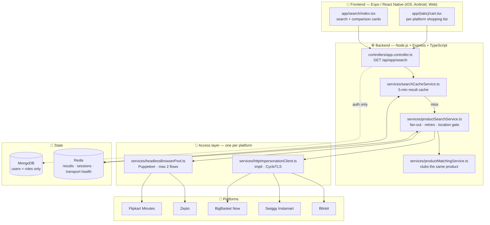
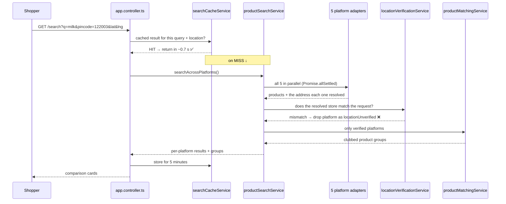
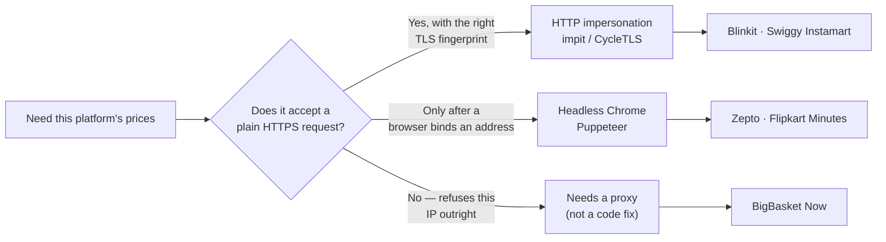
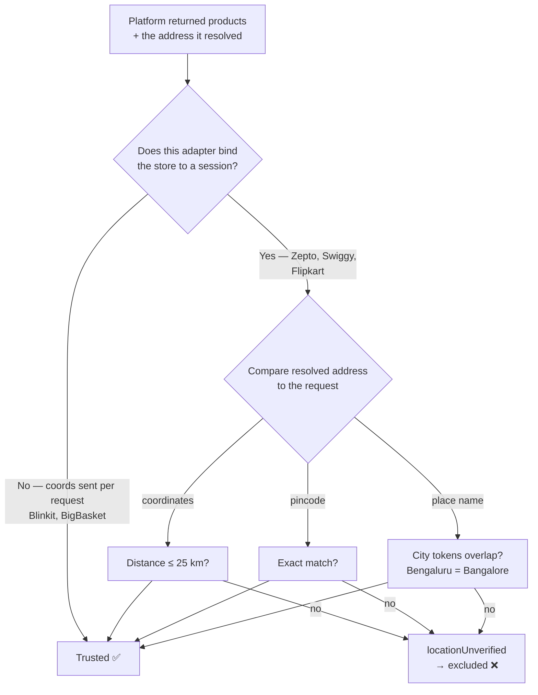
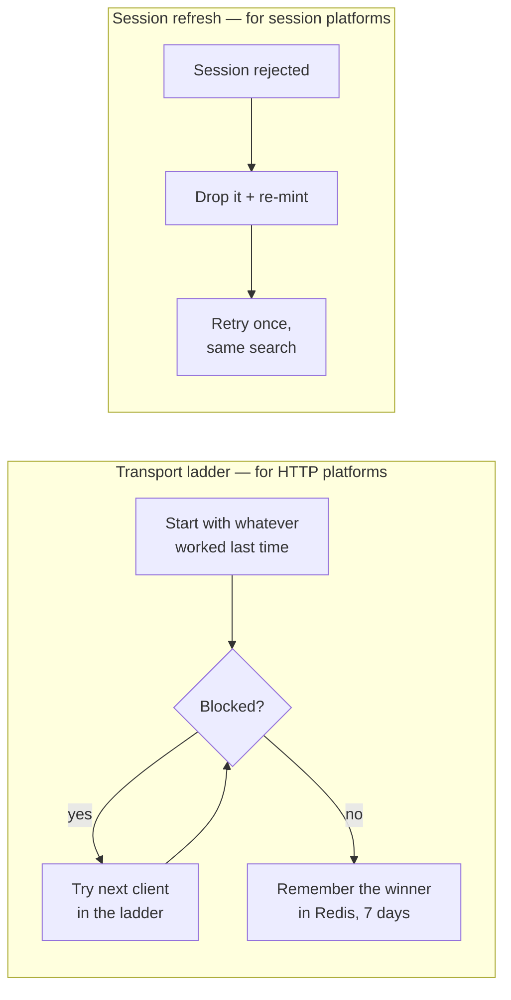

# Price Tracker

Compare the **same grocery item** across India's quick-commerce apps — Blinkit, Zepto, Swiggy
Instamart, Flipkart Minutes and BigBasket Now — at **your** delivery address, in real time.

The hard part is not the UI. It is that none of these platforms has a public API, each binds prices
to a specific dark store near you, and each defends itself against automated access differently.
This document explains how the app gets accurate, location-correct prices anyway.

---

## 1. What it does, in one paragraph

You type a pincode and a product. The backend asks all five platforms at once, each as a different
kind of client, and each pinned to your delivery address. Every platform that answers must **prove
which store it priced against** — if it cannot, its results are thrown away rather than shown, since
a plausible price from the wrong city is worse than a missing column. Surviving results are
normalised into one shape, the same product is clubbed across platforms by name and pack size, and
you see one card per product with every platform's price on it.

---

## 2. Architecture at a glance



**MongoDB is not in the price path.** It stores only `User` and `Role` for the auth routes; if it is
down, search is unaffected (`config/database.ts` fails open on purpose).

---

## 3. What happens on one search



**One platform failing never fails the search** — the fan-out uses `Promise.allSettled`, so each
platform's column succeeds or fails on its own.

---

## 4. How each platform is reached, and why

Three different access strategies, because the platforms defend themselves differently.



| Platform | Approach | File |
|---|---|---|
| **Blinkit** | Direct JSON API. Latitude/longitude go in the request headers, so every call is location-pinned by construction. | `platforms/blinkit.ts` |
| **Swiggy Instamart** | Browser mints a session once per location (AWS WAF token), then fast JSON calls replay it. | `platforms/swiggyInstamart.ts` |
| **Zepto** | Browser picks the address in Zepto's own picker, then reads the search API response the page itself makes. | `platforms/zepto.ts` |
| **Flipkart Minutes** | Browser binds the address via the map sheet's **Confirm**, then searches through the site's own search box and reads the response. | `platforms/flipkartMinutes.ts` |
| **BigBasket Now** | Correct endpoint, blocked at the network. Needs `PRICE_TRACKER_BIGBASKET_PROXY_URL`. | `platforms/bigBasket.ts` |

### Why Flipkart reads instead of replays

The earlier design captured one search request and replayed it over a fast HTTP client. It broke
constantly because **the captured request is not reproducible** — two captures minutes apart carried
different headers (one had `flipkart_secure`, one did not), and Flipkart answers HTTP 406 when it
dislikes the set. Driving the real page sidesteps every unknown: the app builds its own request, and
we just read the answer.

> **Rule of thumb:** replaying a captured request means reproducing the *question*; driving the real
> client means reading the *answer*. Replay only when you control every value in the request.

---

## 5. Keeping prices honest: the location gate

The dangerous failure is not an error — it is a **believable price from the wrong city**. Platforms
that bind a store to a session can silently fall back to a default store.



Implemented in `services/locationVerificationService.ts`, with 11 assertions in
`scripts/verifyLocationVerification.ts`.

**Proof it works.** Regional dairy brands appear only in their own regions — something a default
store could not produce:

| Brand | Gurugram | Bengaluru | New Delhi |
|---|---|---|---|
| Nandini *(Karnataka state dairy)* | — | ₹24 | — |
| Mother Dairy *(Delhi NCR dairy)* | ₹28 | — | ₹30 |
| Amul *(national)* | ₹25 | ₹26 | ₹25 |

---

## 6. Clubbing the same product across platforms

Each platform names things differently: *"Amul Taaza Toned Milk 500ml"* vs
*"Amul Taaza Toned Fresh Milk | Pouch, 1 pack (500 ml)"*. `services/productMatchingService.ts`:

1. **Normalise** — lowercase, strip punctuation, parse the pack size into a common unit (500 ml).
2. **Block** — only compare products with the *same pack size*. 1 L milk never matches 500 ml milk.
3. **Score** — weight rare words (brand names) higher than common ones ("milk" means little).
4. **Cluster** — union-find groups mutually-similar products into one card.

Checked by 19 assertions in `scripts/verifyProductMatching.ts`.

---

## 7. Staying alive as platforms change

Two mechanisms, both self-healing, so routine drift does not need a code change.



- **Transport ladder** (`services/platformTransportHealthStore.ts`) — when a platform learns one
  HTTP client's TLS fingerprint, the next client is tried automatically and the winner is
  remembered. Turns a multi-day outage into one failed request.
- **Session refresh** (`services/productSearchService.ts`) — an expired session is dropped *and*
  retried once in the same search, so the shopper who discovers the expiry is not the one who pays.
- **Health endpoint** — `GET /api/app/health` shows each platform's ladder, last working transport
  and failure counts.

---

## 8. Caching and timing

| Layer | Key | TTL | Why |
|---|---|---|---|
| Search results | query + location | **5 min** | Prices move slowly; repeat searches drop from ~45 s to ~0.7 s |
| Platform sessions | platform + location | **12 h** | Address binding is the slow part — pay once |
| Transport health | platform | **7 days** | Remember which HTTP client works |

Redis falls back to an in-process map if unavailable, so nothing breaks without it — you just lose
caching across restarts.

**Measured:** cold search 22–60 s (browser work dominates), warm search **~0.7 s**.

---

## 9. Tech stack

| Layer | Technology |
|---|---|
| Mobile / web app | Expo, React Native, Expo Router, Zustand |
| Backend | Node.js, Express, TypeScript |
| HTTP impersonation | `impit` (Rust), `cycletls` (Go) — mimic real browser TLS fingerprints |
| Headless browser | Puppeteer (Chromium), max 2 concurrent flows |
| Cache / sessions | Redis (with in-process fallback) |
| Database | MongoDB — **auth only**, not the price path |
| HTML parsing | cheerio |

---

## 10. Running it

```bash
cd backend && npm install && npx tsx src/index.ts     # http://localhost:5000
```

```bash
cd frontend && npm install && npx expo start --web    # http://localhost:8081
```

**Chromium is required in production** — Zepto and Flipkart Minutes cannot work without it. Size the
host for ~2 concurrent Chromium contexts (roughly 1 GB RAM headroom) and install Chrome's system
libraries in your container image.

Useful environment variables:

| Variable | Purpose |
|---|---|
| `REDIS_URL` | Caching and sessions (optional, strongly recommended) |
| `MONGODB_URI` | Auth routes only |
| `PRICE_TRACKER_BIGBASKET_PROXY_URL` | The one thing that would re-enable BigBasket |
| `SEARCH_CACHE_TTL_SECONDS` | Default 300 |

### Verification scripts

```bash
npx tsx src/scripts/verifyLocationMatrix.ts milk      # all platforms × 3 cities + price check
```

```bash
npx tsx src/scripts/verifyProductMatching.ts          # 19 clubbing assertions
```

```bash
npx tsx src/scripts/verifyLocationVerification.ts     # 11 location-gate assertions
```

---

## 11. Current status — honest version

Measured 2026-10-25, query "bread", across Gurugram 122003, Bengaluru 560001, New Delhi 110001.

| Platform | Live prices | Location-verified | Delivery ETA |
|---|---|---|---|
| Blinkit | ✅ 12 items, all cities | ✅ | ✅ per-store (8–11 min) |
| Zepto | ✅ 25–27 items, all cities | ✅ | ❌ not exposed |
| Swiggy Instamart | ✅ up to 32 items | ✅ | ❌ not exposed |
| Flipkart Minutes | ✅ 10 items (Gurugram, Bengaluru) | ✅ | ❌ not in this response |
| BigBasket Now | ❌ IP-blocked | — | — |
| Amazon Now | ❌ disabled, no web surface | — | — |

**4 of 5 platforms return location-verified prices in all three cities.**

### Known gaps

- **ETA is Blinkit-only.** Everyone else returns prices without a delivery estimate. The UI omits it
  rather than guessing.
- **BigBasket needs a proxy.** Its own JavaScript gets HTTP 403 from its own API inside real Chrome,
  so this is the network refusing the IP, not a code problem.
- **Amazon Now has no reachable web storefront.** Amazon documents a "30-Minute Store" nav entry on
  the US site; it does not appear on amazon.in at any covered pincode in a logged-out session.
- **Cart is not persisted** — a refresh empties the shopping list. Needs a platform-split storage
  module.
- **Checkout-time charges** (delivery fees, handling, surcharges) are not yet collected, so the
  comparison is item price only.
